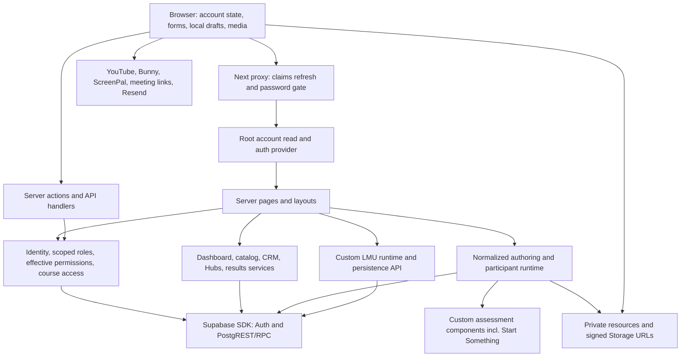

# Full site assessment

PurposeOS combines participant discovery/journey surfaces, global CRM administration, scoped community systems and two curriculum/runtime paths. The breadth is real, but route presence does not establish a finished feature: several administrative areas are explicit future-capability pages (F28). The largest maintainability concern is broad loader reuse and overlapping authorization vocabularies, rather than a need to replace the platform.

All observations below are static. Significant claims refer to finding IDs and their path/line evidence in [07](07-EVIDENCE-REGISTER.md).

## Architecture

**Confirmed by code (F04, F22, F24, F29):** App Router server components coordinate reads; client islands handle account modal, editor recovery, assessment interactions, media and incremental chat. Server-only privileged Supabase client uses a server secret; cookie-backed SSR and browser clients use the publishable key. No direct ORM/database pool is established by the inspected manifest and source searches. Proxy matches most paths, refreshes claims and checks selected experience/result/LMU routes for password protection. It is not a replacement for server action ownership checks.

Root layout loads an account into a client provider. PlatformShell and AdminShell compose shared chrome, but there is no `app/admin/layout.tsx` inventory entry; route components and shared admin components perform guards. Experience and LMU layouts are the other two layout files. There are no local route-specific loading/error/not-found files in the inspected inventory (F25).

State is primarily server data plus local React state/refs, LMU progress persistence, browser draft recovery and targeted fetch state. No installed SWR/TanStack Query state layer is evident in `package.json:35–58`. Own response library has serial eager reads; cohort responses already use outline/box reads with no-store and request-local maps (F10; `lib/platform/response-library.ts:68–110,210–254`). Numeric opt-in server diagnostics exist but were not run (F29).

## Route-to-data-access matrix

`[...]` denotes dynamic parameters. These are route families, not measured request totals. The exhaustive local endpoint filename inventory is appended below.

| Surface / route family | Data/access entry | Boundary and concern |
|---|---|---|
| `/`, `/[hubSlug]` | Public landing content / Hub landing; root account | Public chrome shares account dependency (F04); public page access does not grant private content. |
| `/dashboard`, `/my-journey`, `/purpose-profile` | `getWayfinderDashboard`; Journey also completed results, Profile own library | Signed-in identity/profile; dashboard capability and private participant filters; broad reuse F08–F10. |
| `/account`, password reset/forgot flows | Account API/client settings, profile/auth helpers | Cookie-backed user identity; separate reset confirmation routes. No credential files inspected. |
| `/account/results`, `/account/results/[kind]/[resultId]` | Completed-result list/detail | Participant ownership and password checks; summary body overfetch F09. |
| `/trainings`, `/experiences` | Training catalog / experience surfaces | Public catalog metadata plus signed-in overlay, enrollment/cohort links; completion listing F09. |
| `/experience/[experienceSlug]`, `/experiences/[slug]` | Runtime registry, course resolution/enrollment | Compatibility/entry routing; published version, admission, entitlement and password checks. |
| `/experiences/[slug]/course/...` | `resolveParticipantCourse` → full structure/state/assets/Companion | Fresh course authorization, delivery filtering; requested section selected after F01 full load. |
| `/experiences/[slug]/notes` | Personal-notes experience | Private participant/enrollment notebook; must remain distinct from facilitator data. |
| `/experience-access/[slug]` | Password credential/grant actions | Revision-bound grants, management bypass and return-path validation; proxy/server overlap H03. |
| LMU choose/start/module/original/seniors/student/print routes and legacy aliases | Custom LMU components; `/api/lmu/*` persistence | Dedicated runtime and identity/session infrastructure; preserve F30 custom behavior while improving save acknowledgement. |
| Start Something and other native assessment routes | NativeAssessmentShell + registered components/actions | Existing custom UX with shared enrollment/response persistence (F24); no generic migration proposed. |
| `/hubs/[hubSlug]` | Hub/membership/offerings/effective access/name directory | Profile links permissioned; signed-in directory read broader than membership (F11). |
| `/hubs/[hubSlug]/members/[participantId]` | Scoped Hub member/profile service and response review UI | Must validate viewer scope and target membership independently; private CRM is not public directory data. |
| `/admin`, `/admin/users`, `/admin/users/[userId]`, new/import | Admin identity; registry/detail/import/journey services | Global administrator boundary; people paginated but detail broad and filters ID-based (F06–F07). |
| `/admin/trainings`, new, `[experienceId]` | Admin registry/details and experience mutations | Global guard then build/admin roles; index-wide versions and organizations (`lib/experiences/admin/data.ts:5–15`). |
| Version builder / section layout / previews | Full structure + layout workspace, block/theme actions | Draft-only authoring, registry validation; duplicate reads F14; scoped creator obstruction F13. |
| Version enrollment, delivery and cohorts | Enrollment/offerings/delivery plans/Companion group actions | Existing Hub/cohort/canonical enrollment relationship; version integrity F23. |
| `/admin/trainings/themes/*`, `/admin/resources/*` | Theme configuration, resource metadata/usage | Authoring catalogs; F05 unbounded resource-library usage load. |
| `/admin/admins`, access, settings/classifications, Hubs/organizations | Admin/catalog and authority services | Separate membership/role/entitlement semantics (F31). Destructive authority actions have stronger guards. |
| `/admin/assessments/life-mapping-u/*`, user result details | Custom LMU results and assessment-result services | Global-admin review; history/answer confidentiality. Legacy admin LMU routes redirect (`next.config.ts:15–19`). |
| Admin analytics, projects, events, communications and other scaffold pages | `AdminArchitecturePage` where imported | Guarded future-capability shells, not evidence of deployed operational workflows (F28). |
| `/api/account/*`, `/api/admin/*` | Auth/profile/admin/CRM HTTP handlers | Endpoint-specific identity and target checks required; UI gating is insufficient with privileged client. |
| `/api/cohorts/.../responses` | Cohort reviewer loader | Fresh membership/facilitator authorization and audit on each request; F21 sharing-contract decision. |
| `/api/experiences/[slug]/companion` | Narrow update loader | Fresh authorization, location hierarchy and cohort checks; bounded message window F19. |
| `/api/lmu/*` | Custom assessment/session/section/finalization handlers | Custom persistence; password proxy covers LMU API family. |
| `/dev/*` | Fixture preview pages | Development-only gate demonstrated by `app/dev/native-assessments-preview/page.tsx:7–14`; not runtime assessment data. Other dev surfaces require later completeness verification. |

## Participant workflows and UX

**Dashboard → learning → results:** a participant can discover trainings/assessments, enter a cohort-specific course and return to completed results. Canonical journey history avoids equating an answer snapshot with course completion (F09, F23). However, dashboard, My Journey, My Learning, Purpose Profile, My Profile and Guided Experience Results use overlapping vocabulary (`app/my-journey/page.tsx:13–21`; `app/purpose-profile/page.tsx:9–17`; `app/account/results/page.tsx:8–16`; `components/experiences/builder/ParticipantCourseRuntime.tsx:84`). **Strong static inference:** people may not know which surface is the reliable place for current learning vs saved answers vs finalized artifacts. Remedy: make dashboard the resume surface, Journey the enrollment/history surface, and Profile/results the discovery/artifact surfaces with consistent links. Verify with task-based participant review, not invented click counts.

**Course lesson → save → next:** the runtime separates Save draft, Submit response and Continue. Completion controls describe forward-completion behavior and show completed status (F03). Yet section-visit failures are hidden and response/progress writes can succeed partially. Give cloud-acknowledged saved states, durable retry and distinct completion failure feedback. Submission is final for normal participants; leader/admin bypass permits edits (F03, F21; `lib/experiences/builder/response-mutations.ts:25–50`). Clarify this policy without changing it silently.

**Hub → people:** offering visibility distinguishes public from member/manager context. Names are still fetched for any user and links alone receive profile permissions (F11). Decide directory audience before optimizing it. A list hidden by client styling is not an authorization boundary.

**Own profile → saved work:** collapsed visual sections currently do not defer backend loading (F10). Use a summary outline and fetch the chosen activity, as cohort review already does. Keep old-version artifacts accessible even when current curriculum changes.

## Administration and maintainability

The editor already has a persistent outline, editable titles, drag wrappers and keyboard-accessible up/down forms, draft-only editing, save receipts, preview and publish controls (F14–F16). The problem is complexity and duplicate data paths, not an absence of these capabilities. Course settings, overview, version release, delivery plans, enrollment, themes and resource selection form a substantial administrative surface. Prefer task-focused panels and clear default workflows over a wholesale replacement.

Global CRM administration and scoped course/community authority overlap through two authorization models (F13, F31). Consolidate contracts incrementally; do not cache a single broad “isAdmin” flag as universal authority. Catalog roles such as creator, builder and course admin need owner-approved meanings and migration-safe scope mapping.

Large inline JSX and mixed data loading/rendering in workspaces and registry/detail pages make changes hard to isolate (F07, F14). Separate DTO loaders, authorized mutations and presentation boundaries. Add domain ownership documentation and a real README: the current README is generic scaffolding and describes port 3000 while `package.json:6` uses 3003. This is a confirmed documentation mismatch, not runtime failure.

## Source-visible accessibility and media

Positive patterns: labeled form fields, button names, outline navigation labels/current-page attributes, semantic details, progressbar attributes, role=status/alert and chat log announcements (F15, F19; `components/experiences/builder/ParticipantCourseRuntime.tsx:81–93`). Up/down forms supplement drag interactions (`components/admin/CourseBuilderWorkspace.tsx:30–58`). Preserve them in a simplified design.

Review later: keyboard focus after redirect/save, modal focus containment/escape behavior, drag-only operations elsewhere, mobile panel focus, theme color contrast, heading levels, canvas PDF text accessibility, zoom and reduced motion. These are **Requires Live Verification**, not passed accessibility checks. PDF readers need accessible download/open alternatives and meaningful text descriptions; hero imagery currently uses empty alt as decorative (F26), which is suitable only if it is truly decorative. No browser or automated accessibility audit was performed.

No route-specific loading/error files were found (F25). Add meaningful fallbacks near the expensive page services; avoid generic spinners that obscure whether an answer was saved. Bundle/hydration impact, image byte sizes and actual prefetch behavior remain H05. Server data overfetch does not imply the entire tree is serialized to a client; the course runtime is a server component with client islands (F01, F20).

## Native experience inventory

| Experience | Existing source/runtime | Audit treatment |
|---|---|---|
| Life Mapping U | `app/experiences/life-mapping-u/*`, `lib/experiences/lmu/*`, `/api/lmu/*` | Preserve custom assessment and local/server persistence; improve acknowledgement/efficiency only. |
| Start Something | Dedicated route, `StartSomethingExperience`, registered custom block and mutations | Preserve custom guided flow and completion semantics (F24, F30 distinction). |
| Personal Impact Statement | Dedicated route/component and structured-response mutations | Inventory as native custom-component experience; no migration assumption. |
| Circle of Influence | Dedicated route/component/results; canonical seed | Preserve one canonical reusable assessment (F27). |
| Activate Your Purpose, Wayfinders Ethos, Launching Your Wayfinders Hub | Dedicated routes and registered components | Shared infrastructure efficiency only; registry and visibility decisions apply. |

## Recommended priorities

First resolve F11/F12/F21 privacy/permission semantics and F13 creator authority. Then split data contracts at F01/F02/F08/F10/F14, bound F05/F07 lists, and consolidate F03/F16/F17 state transitions. Prototype simpler creator navigation before coding. Profile H01–H05 later with explicit approval. See [06](06-ROADMAP-AND-DECISIONS.md) for acceptance and rollback.

## Local route filename inventory

The following inventory records page, handler, layout and action locations in this checkout. Route families above supply the data-access mapping; an endpoint filename does not establish functionality, a live response or full authorization correctness.

- `app/[hubSlug]/page.tsx`
- `app/account/forgot-password/page.tsx`
- `app/account/page.tsx`
- `app/account/reset-password/confirm/route.ts`
- `app/account/reset-password/page.tsx`
- `app/account/results/[kind]/[resultId]/page.tsx`
- `app/account/results/page.tsx`
- `app/admin/access/page.tsx`
- `app/admin/account/page.tsx`
- `app/admin/admins/page.tsx`
- `app/admin/analytics/page.tsx`
- `app/admin/assessments/life-mapping-u/[assessmentId]/page.tsx`
- `app/admin/assessments/life-mapping-u/page.tsx`
- `app/admin/assessments/page.tsx`
- `app/admin/automations/page.tsx`
- `app/admin/boards/page.tsx`
- `app/admin/channels/page.tsx`
- `app/admin/cohorts/[cohortId]/page.tsx`
- `app/admin/cohorts/actions.ts`
- `app/admin/cohorts/page.tsx`
- `app/admin/communications/page.tsx`
- `app/admin/events/page.tsx`
- `app/admin/forgot-password/page.tsx`
- `app/admin/forms/page.tsx`
- `app/admin/hubs/page.tsx`
- `app/admin/life-mapping-u/[assessmentId]/page.tsx`
- `app/admin/life-mapping-u/page.tsx`
- `app/admin/login/page.tsx`
- `app/admin/messages/page.tsx`
- `app/admin/notifications/page.tsx`
- `app/admin/organizations/page.tsx`
- `app/admin/page.tsx`
- `app/admin/partners/page.tsx`
- `app/admin/projects/page.tsx`
- `app/admin/recovery/page.tsx`
- `app/admin/reset-password/page.tsx`
- `app/admin/resources/[resourceId]/page.tsx`
- `app/admin/resources/actions.ts`
- `app/admin/resources/page.tsx`
- `app/admin/settings/classifications/page.tsx`
- `app/admin/settings/page.tsx`
- `app/admin/setup/page.tsx`
- `app/admin/tasks/page.tsx`
- `app/admin/timeline/page.tsx`
- `app/admin/trainings/[experienceId]/delivery/actions.ts`
- `app/admin/trainings/[experienceId]/delivery/group-actions.ts`
- `app/admin/trainings/[experienceId]/delivery/page.tsx`
- `app/admin/trainings/[experienceId]/edit-actions.ts`
- `app/admin/trainings/[experienceId]/page.tsx`
- `app/admin/trainings/[experienceId]/versions/[versionId]/actions.ts`
- `app/admin/trainings/[experienceId]/versions/[versionId]/companion-actions.ts`
- `app/admin/trainings/[experienceId]/versions/[versionId]/companion-reconciliation-actions.ts`
- `app/admin/trainings/[experienceId]/versions/[versionId]/enroll/actions.ts`
- `app/admin/trainings/[experienceId]/versions/[versionId]/enroll/page.tsx`
- `app/admin/trainings/[experienceId]/versions/[versionId]/page.tsx`
- `app/admin/trainings/[experienceId]/versions/[versionId]/preview/[moduleKey]/[lessonKey]/[sectionKey]/page.tsx`
- `app/admin/trainings/[experienceId]/versions/[versionId]/preview/page.tsx`
- `app/admin/trainings/[experienceId]/versions/[versionId]/release-actions.ts`
- `app/admin/trainings/[experienceId]/versions/[versionId]/sections/[sectionId]/layout/actions.ts`
- `app/admin/trainings/[experienceId]/versions/[versionId]/sections/[sectionId]/layout/page.tsx`
- `app/admin/trainings/actions.ts`
- `app/admin/trainings/new/page.tsx`
- `app/admin/trainings/page.tsx`
- `app/admin/trainings/themes/[themeId]/page.tsx`
- `app/admin/trainings/themes/actions.ts`
- `app/admin/trainings/themes/new/page.tsx`
- `app/admin/trainings/themes/page.tsx`
- `app/admin/users/[userId]/page.tsx`
- `app/admin/users/[userId]/results/[kind]/[resultId]/page.tsx`
- `app/admin/users/import/page.tsx`
- `app/admin/users/new/page.tsx`
- `app/admin/users/page.tsx`
- `app/api/account/forgot-password/route.ts`
- `app/api/account/logout/route.ts`
- `app/api/account/password/route.ts`
- `app/api/account/preferences/route.ts`
- `app/api/account/reset-password/route.ts`
- `app/api/account/route.ts`
- `app/api/account/signin/route.ts`
- `app/api/account/signup/route.ts`
- `app/api/admin/admins/[memberId]/route.ts`
- `app/api/admin/admins/route.ts`
- `app/api/admin/auth/confirm/route.ts`
- `app/api/admin/classifications/route.ts`
- `app/api/admin/forgot-password/route.ts`
- `app/api/admin/hubs/route.ts`
- `app/api/admin/login/route.ts`
- `app/api/admin/logout/route.ts`
- `app/api/admin/password/route.ts`
- `app/api/admin/recovery/route.ts`
- `app/api/admin/reset-password/route.ts`
- `app/api/admin/setup/route.ts`
- `app/api/admin/trainings/[experienceId]/learners/route.ts`
- `app/api/admin/wayfinders/[participantId]/authority/route.ts`
- `app/api/admin/wayfinders/[participantId]/delete/route.ts`
- `app/api/admin/wayfinders/[participantId]/export/route.ts`
- `app/api/admin/wayfinders/[participantId]/journey/route.ts`
- `app/api/admin/wayfinders/[participantId]/notes/route.ts`
- `app/api/admin/wayfinders/[participantId]/profile/route.ts`
- `app/api/admin/wayfinders/[participantId]/relationships/route.ts`
- `app/api/admin/wayfinders/import/confirm/route.ts`
- `app/api/admin/wayfinders/import/reconcile/route.ts`
- `app/api/admin/wayfinders/route.ts`
- `app/api/cohorts/[cohortId]/members/[participantId]/responses/route.ts`
- `app/api/experiences/[slug]/companion/route.ts`
- `app/api/lmu/assessment/route.ts`
- `app/api/lmu/sections/[sectionKey]/finalize/route.ts`
- `app/api/lmu/sections/[sectionKey]/route.ts`
- `app/api/lmu/session/route.ts`
- `app/dashboard/page.tsx`
- `app/dev/assessment-results-preview/page.tsx`
- `app/dev/native-assessments-preview/page.tsx`
- `app/dev/start-something-preview/page.tsx`
- `app/experience-access/[slug]/actions.ts`
- `app/experience-access/[slug]/page.tsx`
- `app/experience/[experienceSlug]/page.tsx`
- `app/experiences/[slug]/actions.ts`
- `app/experiences/[slug]/course/[moduleKey]/[lessonKey]/[sectionKey]/page.tsx`
- `app/experiences/[slug]/notes/page.tsx`
- `app/experiences/[slug]/page.tsx`
- `app/experiences/activate-your-purpose/page.tsx`
- `app/experiences/circle-of-influence/page.tsx`
- `app/experiences/launching-your-wayfinders-hub/page.tsx`
- `app/experiences/layout.tsx`
- `app/experiences/life-mapping-u/choose/page.tsx`
- `app/experiences/life-mapping-u/dev/icons/page.tsx`
- `app/experiences/life-mapping-u/layout.tsx`
- `app/experiences/life-mapping-u/life-map/print/page.tsx`
- `app/experiences/life-mapping-u/module/[moduleSlug]/page.tsx`
- `app/experiences/life-mapping-u/original/modules/page.tsx`
- `app/experiences/life-mapping-u/original/page.tsx`
- `app/experiences/life-mapping-u/page.tsx`
- `app/experiences/life-mapping-u/seniors/page.tsx`
- `app/experiences/life-mapping-u/start/page.tsx`
- `app/experiences/life-mapping-u/student/page.tsx`
- `app/experiences/page.tsx`
- `app/experiences/personal-impact-statement/page.tsx`
- `app/experiences/start-something/page.tsx`
- `app/experiences/wayfinders-ethos/page.tsx`
- `app/hubs/[hubSlug]/members/[participantId]/page.tsx`
- `app/hubs/[hubSlug]/page.tsx`
- `app/layout.tsx`
- `app/life-mapping-u/page.tsx`
- `app/module/[moduleSlug]/page.tsx`
- `app/my-journey/page.tsx`
- `app/page.tsx`
- `app/purpose-profile/page.tsx`
- `app/trainings/page.tsx`
