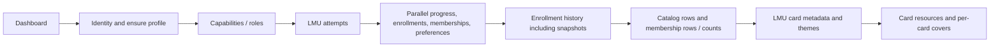
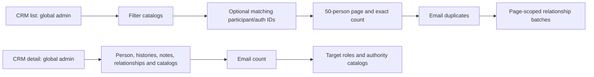
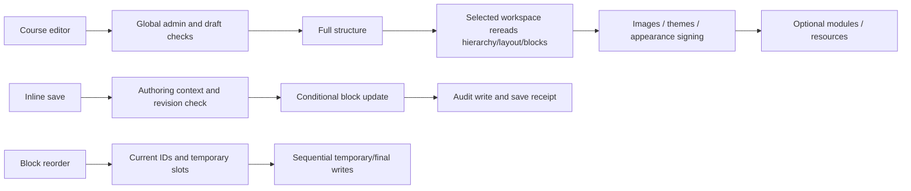
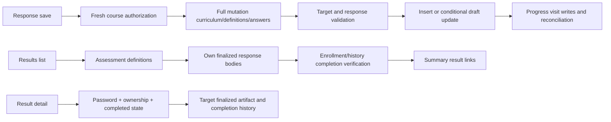

# Supabase and performance assessment

The strongest confirmed efficiency issue is **read scope**, not proven database saturation: full curriculum reads, answer bodies used for list summaries, platform-wide resource usages and eager detail/history loaders. Existing optimizations must be preserved: people pagination, batched related rows, mutation/render separation, targeted chat polling, metadata deduplication and batched display signing (F02, F06, F18–F19). The actual egress source remains unknown.

Evidence classifications and exact path/line references are in [07](07-EVIDENCE-REGISTER.md). All diagrams below show possible static operations, not measured requests. Optional branches and empty data can skip operations.

## Connection and access inventory

| Mechanism | Local evidence | Assessment |
|---|---|---|
| Privileged SDK | `lib/supabase/admin.ts:1–14` | Server-only `createClient`, server secret, no persisted session, measured fetch wrapper. Auth, PostgREST and Storage HTTP; not a direct Postgres connection pool. |
| SSR SDK | `lib/supabase/server.ts:1–24` | Publishable key, cookie adapter; server components cannot always write cookies, proxy handles refresh. |
| Proxy SDK | `lib/supabase/proxy.ts:6–25`, `lib/experiences/access/proxy.ts:15–29` | Claims refresh plus experience/password lookups; protected-grant management may fetch user/authority. |
| Browser SDK | `lib/supabase/client.ts:1–9`, `components/platform/WayfindersAuthProvider.tsx:43–55` | Auth state events plus `/api/account`; not evidence of direct browser curriculum reads. |
| RPC | F16–F17, F22–F23; migrations listed below | Trusted server release, clone, movement, authority, assessment/enrollment operations; preserve target/version guards. |
| Storage | `lib/experiences/builder/resource-assets.ts:47–85,96–155` | Immutable upload paths, type/signature/size validation, cleanup on metadata failure; signed display/download URLs. |
| Realtime | Manifest/source searches | No `.channel`/`postgres_changes` usage found in inspected app/lib/components; chat currently polls HTTP. Do not prescribe Realtime without a need and access review. |
| Direct Postgres/ORM | `package.json:35–58`, inspected SDK callers | No direct driver/ORM path established. Supavisor is not the remedy for these HTTP payloads; revisit only if future direct connections require pooling. |
| External services | `lib/email/signup-notification.ts:25`; LMU video adapters and media registry | Resend signup mail; external embeds/media/meeting links. Their bytes are not automatically Supabase Storage egress. No calls made. |
| Diagnostics | F29 | Numeric request-category counts/times, scoped opt-in; no bytes/billing or full browser/proxy coverage established. |

## Static request-flow maps

F08: many reads are batched, but independent work could start sooner after identity. History snapshot projection and card cover resolution should be narrowed/reused. My Journey then lists completed results; Purpose Profile additionally loads all own saved work (F09–F10).

F06–F07: bounded people query is good; lookup catalogs, matching IDs and detail histories remain broad. A PostgreSQL membership `exists`-style filter or purpose-built invoker RPC could eliminate large ID transfer, but requires scope, count and query-plan verification. Do not add indexes blindly or expose CRM to browser roles.

F11–F12: directory scope is a security decision before caching. Context is loaded twice through helpers (H03). Bound name lists and fetch them only for authorized directory viewers.

F14–F16: editor outline should be lightweight and selected content independent. Preserve autosave CAS and recovery. Atomic reorder is a correctness improvement, not just request optimization. Ordinary action redirects can cause page reload work; use targeted receipts where safe, never bypass draft authorization.

```mermaid
flowchart LR
  Course[Lesson navigation] --> Auth[Identity, password, participant, roles, access rows]
  Auth --> Version[Published pinned/current version]
  Version --> Tree[All curriculum rows across dependency stages]
  Tree --> Delivery[Cohort/template visibility overrides]
  Delivery --> Responses[All course definitions then own responses]
  Responses --> Progress[Private progress summary]
  Progress --> Media[Appearance / all-course asset signing and Companion]
  Media --> Section[Select requested section and render]
  Section --> Visit[Client visit action: authorize + mutation tree + progress writes]
```

F01–F03: the mount action is another operation beyond the initial render. Narrow visit/save contexts and reuse authorized context internally. Keep fresh authorization at separate HTTP/action boundaries. No claim that all server data enters browser props is made.

F09/F15: use result metadata/read projections while retaining legacy completion validation; result detail should load one artifact. CAS exists for custom assessments; generic response draft update does not use `updated_at` revision and can return no affected-row signal (F03 evidence). **Strong static inference:** races between finalization and draft saves can give ambiguous feedback; verify before extending concurrency policy.

## Schema relationships

| Domain | Relationships and integrity | Local evidence |
|---|---|---|
| Identity / LMU | participants → custom assessments → section progress/responses/results; hashed legacy session tokens | `20260831134921_phase_1_lmu_backend.sql:1–126`; `20260831184303_participant_auth_identity.sql:1–16`; session resolver `lib/experiences/lmu/server/session.ts:27–43` |
| Organization / community | organizations → Hubs; participants through org/Hub/cohort memberships; scoped role assignments | `20260907140629_purpose_os_foundation.sql:19–87,188–216`; classification additions in `20260907181915_participant_classifications.sql:4–37` |
| Curriculum | experiences → versions → modules → lessons → sections → layouts → columns → blocks | `20260907140629_purpose_os_foundation.sql:88–186`; `20260914190028_reconcile_a1_core_lms_foundation.sql:86–263,265–401` |
| Private work | canonical enrollment and version → definition/response, lesson/section/experience progress; history snapshot | `20260907140629_purpose_os_foundation.sql:218–328`; F23 migrations |
| Delivery | offering tied to experience and optional version/Hub/cohort; reusable templates and cohort plans override source curriculum | `20260907190857_hub_context_and_experience_offerings.sql:36–116`; `20260914190032_reconcile_a2_themes_privacy_delivery_plans.sql:86–281` |
| Companion | versioned modules + stable keys → offering/plan overrides → resources, chat/calls; private personal notes linked to canonical enrollment | `20260917114858_companion_framework.sql:8–183`; `20260917124327_companion_live_group.sql:7–172`; `20260919160000_personal_notes_v2.sql:14–247` |
| Assets | resources metadata + immutable private objects; block/Companion links; resource-course associations; version/theme JSON resource references | F18; `20260918145216_resource_library_metadata.sql:36–54` |
| Authority | catalog roles → role entitlements/permissions → per-user/scoped overrides; separate legacy admin membership | `20260923163326_authority_entitlements_foundation.sql:12–91`; F31 |
| CRM | participants/relationships/notes; import batches/rows; admin audit log | `20260908164531_wayfinder_crm_foundation.sql:22–54`; `20260908172648_wayfinder_csv_imports.sql:4–61`; `20260831152647_alpha_admin_backbone.sql:18–41` |
| Reusable assessments | registry and parent/child attempts preserve canonical assessment enrollment | `20260926145218_reusable_prebuilt_assessment_blocks.sql:38–90`; F27 and `20261008190000_unify_native_course_assessments.sql` |

Composite FKs protect section lesson/module/version ownership and layout/column consistency (F22–F23). JSONB stores configuration, response data and historical artifacts. It provides flexibility but increases broad-select payloads and makes some usage relationships implicit; no universal JSONB GIN recommendation follows. Extract fields/projections needed by a query first. Stable keys and registry/schema versions remain important for historical interpretation.

## RLS, privileged routines and indexes

**Confirmed by code (F22):** foundational local migrations enable RLS and revoke anon/authenticated access, granting service-role access. This is a server-mediated model, not an application relying on many costly browser-visible per-row policies. No evidence supports claiming RLS evaluation is the egress cause. Server-side ownership/scope checks are mandatory because privileged reads bypass RLS. Password grants do not replace enrollment/entitlement checks.

Release/movement/authority functions generally use `SECURITY INVOKER`, empty search path and restricted execute. Account deletion is a deliberate exception: private cleanup and public service-only deletion helpers use `SECURITY DEFINER`, with revocations and active super-admin validation (`supabase/migrations/20261002181510_super_admin_user_deletion.sql:6–103`). This is not automatically an exposed public exploit. Verify deployed function ACLs, session revocation and stale-token behavior later, separately approved.

| Candidate concern | Existing local index evidence | Static assessment / later verification |
|---|---|---|
| Curriculum lookup/order | Foundation version/module/lesson indexes `20260907140629...:342–347`; section lesson-sort/version and column layout-sort indexes `20260914190028...:204–211,256–263` | Do not claim missing curriculum indexes wholesale. Narrow payload first; check actual filter/order plan later. |
| Canonical enrollment/access | Unique participant/course F23, offering/status indexes `20260907190857...:85–116`, enrollment version-policy index `20260917210134...:48–49` | Existing keys support ownership. Combined status/time predicates may need tuning at scale, not proven. |
| Personal notes | Enrollment recent and participant-course indexes `20260919160000...:121–134` | Bound UI history; no index change justified without workload. |
| Chat window | Delivery chronology/author indexes `20260917124327...:75–78`, enrollment indexes `20260919123000...:53–59` | Cursor/body filtering first; multi-override grouping and per-channel fairness need plan/behavior testing. |
| CRM substring search | People filter code F06; no trigram declaration found in migration structural searches | **Hypothesis H04:** leading-wildcard ilike may scan at scale. Do not add extension/index without cardinality/search requirements. |
| Participant history scans | History unique open interval on enrollment and version/enrollment index F23; reads filter by participant in F08–F09 | Candidate participant-oriented index/projection; check all deployed indexes and plan before adding. |
| Audit detail | Created-at/admin indexes `20260831152647...:29–30`; query filters entity_type/entity_id F07 | Candidate `(entity_type,entity_id,created_at)` access path; unmeasured. |
| Resource usage | Reverse resource-link indexes in foundation `...:350`; association experience index `20260918145216...:47–48` | Global scans bypass the benefit of selective filtering. Server-side selected-resource usage aggregation first. |
| Publish-forward | Enrollment/version locking and active follower loop `20260917211108...:405–441,715–751` | May hold locks with many active learners; requires live/staging plans and bounded contention measurement. |

Local declarations are not proof that these indexes/grants exist in production. Reconciliation migrations are additive and can preserve older objects. No remote introspection, SQL or advisor runs occurred.

## Egress investigation

| Category | Static signals | What cannot be concluded | Preferred intervention after verification |
|---|---|---|---|
| Database API egress | Full block content/definitions/answers; broad histories/resources/CRM detail (F01–F10) | Traffic frequency, response bytes, total billing share | Explicit DTOs, projections, selective reads, paging and request dedupe. |
| Storage egress | Private PDFs/images, eager mounted readers, original images, URL changes (F18/F26) | File download frequency, cache hits, ranges, actual transferred bytes | Current-page signing, stable valid URLs, reader deferral, derivative thumbnails, download on demand. |
| Storage API overhead | Batch display + per-resource download signing F18 | Signing requests are not equivalent to asset bytes | Defer download signing and reuse within request, keep filenames. |
| Auth | User/claims/account/password overlap F04 | Billing attribution and latency | Dedupe read-only render context; retain refresh and action checks. |
| Other transfers | External video, Next static/RSC responses, Resend | Not necessarily Supabase billable egress | Inspect separately; do not conflate providers. |

No percentage reduction estimates are justified. Pro can provide needed capacity, but plan choice and root cause require the billing category breakdown, usage trends and approved sampling (H01–H05). Region alignment, saturation, connection limits and production query plans are **Requires Live Verification**. Switching to Supavisor would not inherently reduce PostgREST/Storage bytes.

## Priority interventions and verification

1. F12/F11/F21: correct unavailable-state handling and policy semantics before cache reuse. Risk: changing intended privacy; owner decision required.
2. F01/F02/F14: small authorized DTO loaders for outline/current section/mutation. Verify completion, visibility, historical routes, password revocation, cohort mismatch and version pinning; risk: missing previously implicit full-tree semantics.
3. F05/F07/F09/F10: query-side paging, summary projection and lazy activity/tab loads. Verify row-cap fixtures and error states; risk: losing historic artifacts or usage references.
4. F03/F16/F17: atomic/idempotent progress/order/release boundaries. Verify interruption/concurrency/retry; risk: migrations or release-state regressions.
5. F18–F20/F26: narrower media/Companion reads and delta bodies. Verify expired assets, filenames, message deletions/timestamps, membership loss; risk: stale capabilities or dropped history.

## Migration inventory and review coverage

Every local migration was included in structural searches for tables, indexes, RLS, policies, grants and privileged functions. Targeted branch reading focused on relationships and risky operations described above. This is not a deployed ledger or exhaustive formal SQL verification. Historical comments claiming live state are treated as documentation, not as present evidence. The full filename inventory follows.

- `supabase/migrations/20260831134921_phase_1_lmu_backend.sql`
- `supabase/migrations/20260831152647_alpha_admin_backbone.sql`
- `supabase/migrations/20260831152756_index_admin_members_invited_by.sql`
- `supabase/migrations/20260831181243_backfill_lmu_assessment_completion.sql`
- `supabase/migrations/20260831184303_participant_auth_identity.sql`
- `supabase/migrations/20260907140629_purpose_os_foundation.sql`
- `supabase/migrations/20260907181915_participant_classifications.sql`
- `supabase/migrations/20260907190857_hub_context_and_experience_offerings.sql`
- `supabase/migrations/20260908164531_wayfinder_crm_foundation.sql`
- `supabase/migrations/20260908172648_wayfinder_csv_imports.sql`
- `supabase/migrations/20260914190028_reconcile_a1_core_lms_foundation.sql`
- `supabase/migrations/20260914190032_reconcile_a2_themes_privacy_delivery_plans.sql`
- `supabase/migrations/20260915120000_atomic_experience_version_publish_clone.sql`
- `supabase/migrations/20260915182827_version_course_shell_mode.sql`
- `supabase/migrations/20260915235913_version_course_configuration.sql`
- `supabase/migrations/20260916094854_native_media_storage_foundation.sql`
- `supabase/migrations/20260916101839_native_media_block_types.sql`
- `supabase/migrations/20260916154632_increase_native_asset_limit_to_25mb.sql`
- `supabase/migrations/20260916180435_add_atomic_draft_lesson_movement.sql`
- `supabase/migrations/20260917103401_access_enrollment_foundation.sql`
- `supabase/migrations/20260917114858_companion_framework.sql`
- `supabase/migrations/20260917115823_companion_offering_isolation.sql`
- `supabase/migrations/20260917124327_companion_live_group.sql`
- `supabase/migrations/20260917210134_publish_forward_enrollment_policy.sql`
- `supabase/migrations/20260917211108_atomic_publish_forward.sql`
- `supabase/migrations/20260918112528_canonical_enrollment_multiple_cohort_contexts.sql`
- `supabase/migrations/20260918120841_companion_module_availability_context.sql`
- `supabase/migrations/20260918132742_companion_chat_curriculum_context.sql`
- `supabase/migrations/20260918145216_resource_library_metadata.sql`
- `supabase/migrations/20260919123000_live_companion_canonical_enrollment_fk.sql`
- `supabase/migrations/20260919160000_personal_notes_v2.sql`
- `supabase/migrations/20260921221102_custom_code_card_configuration.sql`
- `supabase/migrations/20260922123626_seed_wayfinders_hub_main.sql`
- `supabase/migrations/20260922180041_secure_admin_invitation_activation.sql`
- `supabase/migrations/20260923132211_secure_existing_user_role_management.sql`
- `supabase/migrations/20260923163326_authority_entitlements_foundation.sql`
- `supabase/migrations/20260926145218_reusable_prebuilt_assessment_blocks.sql`
- `supabase/migrations/20261002131605_experience_password_credentials.sql`
- `supabase/migrations/20261002181510_super_admin_user_deletion.sql`
- `supabase/migrations/20261002182856_section_move_content_cascade.sql`
- `supabase/migrations/20261002190000_custom_code_completion_history.sql`
- `supabase/migrations/20261008160000_wayfinders_hub_main_description.sql`
- `supabase/migrations/20261008173651_circle_of_influence_assessment.sql`
- `supabase/migrations/20261008190000_unify_native_course_assessments.sql`
