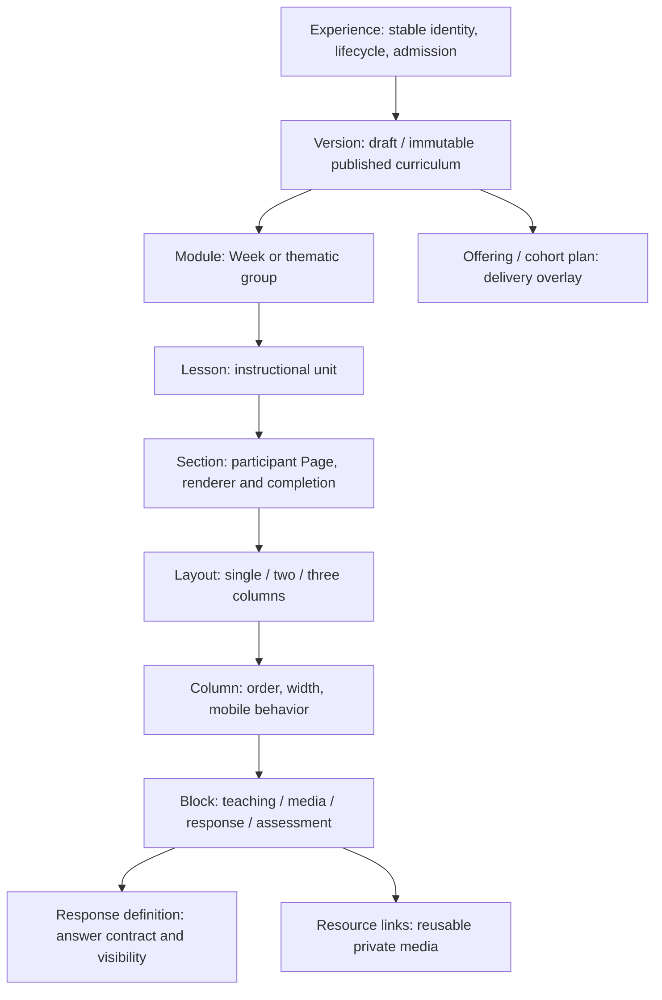

# Course builder assessment

The current builder already has many elements of the proposed simpler interface: persistent outline, inline title/text edits, add-content/page controls, preview, publish, read-only published versions and browser recovery. Preserve those investments. The recommended redesign hides default Section/Layout/Column complexity while retaining it in storage, removes duplicated reads, and makes creator authority and saving states explicit. A deeper model replacement is not justified by this static audit.

Finding references below point to [07](07-EVIDENCE-REGISTER.md). Current course content was not fetched. The assignment identifies one general-builder baseline course; local Hub Leader import documentation and a course-specific runtime branch support using Hub Leader as a source-level example, not a verified deployed inventory. Historical proposal: 16 groups, 18 lessons, 67 pages and 197 blocks (`docs/imports/hub-leader-cohort-1753-import.md:39–60,314–320`). Kaleo scripts exist but do not establish the 32-week curriculum contents in this checkout.

## Actual hierarchy

F22–F24: storage relations protect version ownership and valid hierarchy; generic renderer paths coexist with explicit custom assessment blocks and route handoffs. The course shell and Companion are separate delivery structures, not additional mandatory content layers.

| Layer | Why it exists / storage value | Creator exposure | Steps/read work and simplification risk |
|---|---|---|---|
| Experience | Stable slug, discovery/access/lifecycle, owner, current published pointer | Course details; access settings available to appropriate manager | Keep identity separate from revision; collapsing into a document would lose lifecycle and enrollment anchors. |
| Version | Draft isolation, publish/clone, history compatibility | Clear “Draft changes” and “Published release”; advanced release history | Must remain stored. Hide routine UUID/release bookkeeping; never edit published curriculum in place. |
| Module | Weekly/theme grouping, requirements and ordering | Week/Module according to terminology | Useful for 32 weeks; compact outline read sufficient. Keep configurable label and keyboard reorder. |
| Lesson | Learning unit containing meaningful pages | Primary editor selection | Default content page created with lesson; preserve meaningful multipage lessons. Do not require redundant identical titles. |
| Section | Page-level routes, completion and renderer | Implicit Content for ordinary lessons; optional pages for longer flows | Necessary for current routes/progress/delivery plans. UI can hide default page without schema collapse. Removing it risks old routes/section progress. |
| Layout | Single/two/three-column participant composition | Optional advanced Layout control | Single-column automatic default. Store layout for integrity; no separate setup screen required for normal text. |
| Column | Width/mobile order/sticky/collapsible behavior and block location | Only when advanced layout chosen | Keep stored; hide “column ID/key” details. Validate mobile required content is accessible. |
| Block | Typed content and response/media contracts | Inline content cards and add-content menu | Essential; stable keys and registry validation matter. Expose useful configuration, not renderer internals. |
| Response definition | Type, configuration, required state, privacy/result rules | Prompt/response type and explicit sharing summary | Preserve contract/version association. Resolve F21 policy ambiguity before adding facilitator defaults. |
| Resource | Reusable object/metadata with links | Searchable library/upload picker | Keep dedupe and private signing; page selections do not require loading platform usage. |
| Delivery plan / offering | Cohort-specific visibility/order/config separate from canonical course | Facilitator delivery workspace | Keep separate from ordinary authoring; simplify overlay UI without duplicate cohorts/enrollments. |

**Confirmed by code:** each full-tree read traverses these layers across dependent batches (F01); editor rereads selected layers already loaded (F14). This does not mean normalization itself is slow. A narrow query contract can preserve normalized storage while eliminating broad repeated payloads.

## Creator workflow assessment

Workflow existence is confirmed where cited; usability consequences are **Strong static inference** until creator walkthroughs. No exact click counts or task timings are claimed.

| Task | Current source path / behavior | Friction/failure mode | Proposed UI or data remedy |
|---|---|---|---|
| Create course and details | `/admin/trainings/new`, experience mutations create experience then initial draft (`lib/experiences/admin/mutations.ts:33–65`) | Global admin gate precedes role model; details include delivery/access vocabulary | Simple title/summary/owner setup, default generic course settings; retain safe rollback on failed draft creation. |
| Add Week/Module | Outline form and inline titles (`components/admin/CourseBuilderWorkspace.tsx:34–59`) | Repeated hierarchy controls and expanded rows can crowd long courses | Persistent compact outline, progressive expansion, predictable keyboard selection. |
| Add Lesson/content page | Add lesson and page forms same outline; create section creates default layout/column (`lib/experiences/admin/curriculum-mutations.ts:133–186`) | Creator sees Lesson and Page distinctions for even one-page content | Default lesson content page implicit; “Add another page” optional. Preserve existing page titles/routes. |
| Formatted teaching | TipTap Markdown inline editor, toolbar, course link picker (F15) | Multiple editor instances/link lists; saves/conflict state must remain understandable | Focused inline editing; keep rich text subset and revision receipts, defer inactive toolbars if profiling supports it. |
| Image/upload/reuse | Block mutation media configuration and private asset upload (`lib/experiences/admin/block-mutations.ts:67–78`; F18) | Catalog limits can hide old asset choices; upload/metadata/link operation is multistep | Search/paginate resource picker and inline upload feedback; preserve immutable uploads/signature validation. |
| Video | Validated URL/media registry; external providers | Provider configuration vs learner view can be confusing | Simple URL control with validated preview/provider label; no unnecessary video copying into Storage. |
| PDF/download | PDF-reader and document/file options; reading/download settings | Creator may choose a reader for a large download-only artifact | Explain “Read here” vs “Download”; show file size and accessible alternatives without exposing implementation details. |
| Reflection/short/select response | Typed block registry creates linked response definition (F21/F24) | Required/completion/share settings span content and definition | One prompt panel: response type, required state, finality and audience summary. Reject incompatible contracts before publish. |
| Reusable assessment | Prebuilt assessment selection, launch card and canonical attempts | Embedded/standalone progress is nontrivial | Reuse canonical assessment; clear completion behavior. Do not copy LMU/Start Something into generic lessons. |
| Two-column layout | Separate layout page/actions and current selected workspace | Layout/columns expose advanced structure and repeat reads | Optional inline layout panel; defaults mobile stacking; keyboard order/width controls. |
| Reorder/move | Outline drag with up/down controls; block ordering loops; atomic lesson/section movement migrations (F16) | Partial reorder writes; drag/save/navigation interaction | Atomic validated order operation; preserve non-drag alternatives and selection/focus. |
| Duplicate content | Block duplication and clone release (F17/F23/F32) | Native resource links are not copied by block duplicate; uploaded PDF/image copies can lose assets | Repair link copying with transactional consistency; offer copy/template action with explicit copy scope; module/lesson template capabilities require design and tests, not assumed complete. |
| Theme/customization | Workspace loads themes/images; separate theme and customization panels (F14) | Global vs version appearance confusion, extra catalog reads | Course-level previewable style presets and simple overrides; advanced theme management outside routine authoring. |
| Preview | Device frame and version preview routes; runtime preview is read-only | Preview may hide live cohort/access behavior and does not prove save flow | Persistent preview entry, view as participant/facilitator context where authorized; banner states which actions are disabled. |
| Access/password | Experience overview, access mutation, password controls | Visibility, admission, enrollment and password are distinct concepts | Single access summary with plain labels; detailed policy controls for course manager. Fresh server checks retained. |
| Save | Inline debounced CAS + browser recovery; explicit forms and redirects | Different save modes; storage failure/conflict can block UI | Persistent saved/saving/unsaved/error/conflict states; preserve save-all/discard/navigation guards. No blanket debounce increase without evidence. |
| Publish | Readiness validation then atomic RPC; post-publish operations (F17/F24) | Errors may describe partially completed release | Readiness review, clear release outcome, retry/reconcile delivery phases; preserve immutable history. |
| Revise | Clone published version with stable Companion keys into draft (F17/F23) | Creator may confuse metadata-only draft vs full clone | One “Edit published course” flow that explains draft isolation and follows safe clone path. |
| Archive/withdraw | Experience lifecycle controls and runtime inactive/archived denial (`lib/experiences/builder/participant-runtime.ts:149–170`) | Archive effects on enrollment/results need clear policy | Plain lifecycle summary and retained-history policy; historical access verification is future work. |

## Two alternatives

| Criterion | UI-first simplification (preferred) | Deeper authoring model/API redesign |
|---|---|---|
| Shape | Course → Week/Module → Lesson → Content; optional pages/layout | Collapse/restructure section/layout/column or introduce document/package authoring source |
| Simplicity | Hide defaults and consolidate task panels; existing outline/autosave reused | Could reduce internal concepts, but requires editor and serialization redesign |
| Flexibility | Preserves multipage lessons, advanced layout, custom blocks and delivery plans | Risk of losing route/progress/layout semantics unless rebuilt explicitly |
| Performance | Narrow outline/current-page DTOs and trusted context reuse; normalization remains | Not inherently faster; replacing schema while still loading all weeks would retain main issue |
| Security | Existing version/target checks retained; explicit viewer contracts | New contract needs comprehensive authorization and private-data review |
| Compatibility | Existing sections/keys/results/progress/history unchanged | Requires mappings, migrations, dual readers, response preservation and rollback |
| Effort | Moderate UI/data-contract work, selected correctness RPCs | Large migration/release/runtime effort, higher operational burden |
| Trigger to choose | Current evidence supports it (F01/F14/F15/F23) | Only if real pilot requirements cannot be expressed or normalized selective reads remain measurably insufficient |

Do not conflate a **delivery read model** with a **new authoring source of truth**. A future immutable package can be derived from normalized curriculum without moving creator storage or private state. Any derived layer adds publish-time validation and drift responsibility; evaluate it against selective reads first ([05](05-KALEO-COURSE-ARCHITECTURE.md)).

## Keep / Simplify / Replace / Remove

| Decision | Components/workflows | Reason |
|---|---|---|
| Keep | Experience/version identity, canonical enrollment/history, schema FKs, block registry, private resources, custom LMU/Start Something, inline CAS/recovery, outline, device preview | Proven source-level safeguards and meaningful learning structure (F15/F22–F24). |
| Simplify | Default single-page/single-column authoring, course settings, prompt configuration, terminology, publish readiness, resource selection | Reduce creator-visible complexity without data migration. |
| Replace incrementally | Full-tree render/save loaders, duplicate layout loader, multi-call reorder/progress, ambiguous post-publish outcome | Explicit narrow contracts and atomic/recoverable operations improve both clarity and failure behavior. |
| Remove from default UI | UUID/renderer/key bookkeeping, routine column setup, unsupported custom section options, duplicate settings entry points, misleading future-feature expectations | Keep necessary internal capability; remove accidental interface complexity, not current learner artifacts. |

## Visual prototype before coding

Future work only: a reviewable HTML prototype showing (1) 32-week outline with current lesson selection; (2) default teaching + video + resource + reflection editing; (3) optional multipage/two-column panel; (4) template copy preview; (5) save/conflict/recovery states; (6) participant/facilitator preview; (7) publish/version/access summary. Include desktop and narrow layouts plus keyboard navigation. No prototype was created in this audit because the brief permits only the eight Markdown reports.

Success should be defined by a creator completing these tasks confidently, explaining draft vs published state and response privacy correctly, and not losing work during navigation. Performance acceptance concerns payload/query scope and measured interaction after approval, not arbitrary click counts. See [06](06-ROADMAP-AND-DECISIONS.md).
