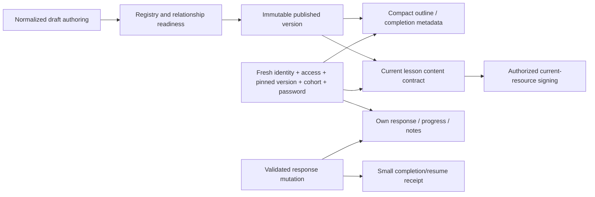

# Kaleo course architecture

Kaleo's 32 weeks should stress-test delivery scope and creator clarity, not trigger an immediate schema replacement. Prefer a **compact versioned outline + on-demand lesson content + separate private state**, initially read selectively from the normalized tables. Retain existing canonical enrollments, Hub/cohort memberships, delivery overlays, version history and custom assessments. Immutable packages remain an optional derived optimization after measurement.

The 32-week duration is a requirement from the brief. Importer profiles and source references exist (`scripts/imports/import-kaleo-888.mjs:14–18,104–108`), but the complete curriculum is not established by this repository audit. No archive was opened or import executed. Teaching, video, resources, practices, reflections, facilitator notes, cohort participation and self-guided mode below are requirements to validate, not claims about actual lesson contents.

## Three distinct viewers

| Viewer | Essential tasks/data | Authorization boundary | Excluded by default |
|---|---|---|---|
| Course Creator | Draft outline, selected lesson blocks/contracts/resources, style, revision, preview/readiness; template copies | Scoped training/owner authority; explicit publishing permission; draft editable check | Other participants' answers, private notes, unrelated CRM and cohort operations. Current global admin gate F13 must be resolved. |
| Facilitator | Assigned cohort/offering, effective week/lesson plan, relevant guide/resources, participant progress summaries, responses explicitly allowed for review, call/chat settings | Active cohort facilitation or approved scoped authority; target membership and course/version context on each request | Other cohorts, private participant notebook, arbitrary CRM, automatically all assessment answers. F21 policy decision required. |
| Participant | Resume/current lesson, compact outline/progress, allowed teaching/media, own draft/final response and results, applicable cohort context | Own canonical enrollment or eligible access, pinned published version, active context, password grant, delivery/audience check | Draft curriculum, facilitator-only resources/notes, other learners' answers and private administration. |

Reuse current Hub → cohort membership → offering/cohort plan instead of creating a second Kaleo cohort system. Canonical enrollment stays one participant/course journey; explicit cohort selection supplies delivery context (F23). A participant in two cohorts does not require two copies of all private responses. If requirements demand cohort-specific separate answers, that is a product/schema decision requiring compatibility design; current canonical model must not be changed implicitly.

## Delivery alternatives

| Criterion | 1. Selective normalized reads | 2. Immutable manifests + per-lesson packages | 3. Hybrid outline + on-demand lesson + private state (preferred) |
|---|---|---|---|
| Query mechanism | Exact current hierarchy/layout/block/contract reads; compact metadata for outline and requirements | Publish derives immutable outline/content artifacts keyed by version/schema/lesson | Define separate read contracts; start with selective normalized implementation, optionally cache/derive public-content packages later |
| Payload | Current location plus compact summary; no all-week bodies | One small manifest and current package; private state still separate | Course entry gets outline; lesson gets current content and response/progress projection |
| Access | Fresh scope/version/audience before reads | Fresh scope before serving package; never public bucket just because immutable | Fresh context before cached content and private state; delivery overlays/policy remain authoritative |
| Caching | Request-local first; immutable content function cache possible | Strong immutable content cache potential; signed URLs must remain outside | Cache stable outline/content; private state user-scoped; fresh access on every operation |
| Publication | Existing normalized validation/RPC plus explicit DTO compatibility | Package generation/validation, checksum, schema version, atomic readiness/pointer and orphan cleanup | Existing publish initially; later derived package readiness gate only if warranted |
| Operations | Minimal new infrastructure; several small related reads | New artifact lifecycle, generation failures, decoder upgrades, retention/drift | Small contracts and invalidation ownership; moderate complexity |
| Migration | Usually reader/action refactor with existing IDs | Derived artifact storage and publishing workflow; authoring need not migrate | Incremental reader replacement; no requirement to collapse sections/columns |
| Rollback | Reader switch back; preserve writes/version IDs | Retain original normalized source/version; select old reader/package schema | Feature-gated new reads with unchanged private ownership/version semantics |
| Main risk | Query breadth creeps back; completion semantics accidentally depend on full tree | Authorization omissions, stale overlays, package/DB drift and partial publication | Multiple explicit DTOs must stay compatible and tests must cover cross-viewer isolation |
| Choose when | First benchmarkable baseline and low operational appetite | Measurements show selective reads/cache insufficient or offline/static artifact requirement emerges | Current evidence F01–F02/F23 supports scope separation without package-first mandate |

Option 3 is a logical delivery contract, not necessarily a new database layer. It can be implemented using option 1. There is no evidence that immutable packages would automatically outperform well-scoped queries or reduce total cost after publish overhead.

## End-to-end participant path

These are exact **types of data**, not promised query counts. Adjacent selective queries may be combined through joins/RPC where justified. Never remove authorization to reach an arbitrary request budget.

| Step | Needed data / necessary reads or writes | Reuse and cache scope | Failure/retry and invalidation |
|---|---|---|---|
| Dashboard | Own identity/profile, enrollment cards, pinned/current release, current location, compact progress/result summaries and permitted cohort entries | Reuse account/authorization within request; cards/public metadata separately cached; own summaries session-private | Unavailable panels distinct from empty. No answer bodies or entire course; enrollment/role/completion changes refresh relevant cards (F08–F09). |
| Open Kaleo outline | Current authorization, enrollment/version/cohort selection, delivery plan revision, module/lesson/page keys/titles/order/required metadata; own compact progress/resume | Immutable version outline cache behind fresh access; delivery overlay separate; private progress keyed enrollment/version | Reject ambiguous or mismatched cohort. If release unavailable, retain clear recovery link and history; no silent version switching (F23). |
| Open current lesson | Exact location belonging to version and visible delivery; selected section/layout/blocks, schema/contracts, own current answers/status/revisions, current-resource metadata, applicable Companion module summaries | Reuse existing session outline for UI only; fresh server access; version/location content cache, private answer state separate | Preserve input/recovery on content or signing failure. Retry current content, not 32 weeks. Required media unavailable should be explicit. |
| Save reflection draft | Fresh auth/access/password and exact response definition ownership/version/type; validated input + expected revision/idempotency key; insert/update one response | Trusted authorized mutation context reused internally, never browser-supplied proof | Return committed response revision/status. Network ambiguity: retry idempotently/read target acknowledgement; conflict retains local text. Do not replay draft over final. |
| Submit reflection | Same contract plus required validation and finality rules; write finalized response; required-section completion/reconciliation | Reuse compact requirement metadata and authorized target; private summary updated | Distinguish “answer saved, progress not confirmed.” Retry completion independently without duplicating final artifact (F03/F15). |
| Next lesson | Current required activity statuses, valid next visible target; progress/resume transition; next lesson package on demand | Reuse outline and requirement metadata; selectively prefetch next authorized text after current page useful; no media preload across weeks | Preserve current work on failed transition; next request confirms version/context. Optional browse-ahead is explicit course policy. |
| Return visit | Fresh user/access/version/context; compact dashboard/resume; selected lesson and latest own state | Cached immutable content may be reused after access check; own state refreshed; signed URLs only if still valid | Refresh expired signed URLs after authorization; preserve PDF position where possible; logout/role loss clears private UI. |

Completion is a **server-derived result** of visible required activities and policy, not a browser percentage. Today the full tree supplies these rules; a selective reader must carry compact requirement metadata sufficient to reproduce them (F01/F03). Do not optimize by omitting invisible/optional handling, embedded assessment completion, manual-completion or historic-navigation rules. Existing Hub Leader browse-ahead exception is course-specific (`lib/experiences/builder/progress-mutations.ts:129–134`); Kaleo's policy must be decided rather than copied.

## Version integrity and progress preservation

**Confirmed by code (F23):** enrollments support `follow_current` and `locked`; completion history can retain artifacts; canonical participant/course enrollment is unique; runtime checks version belongs to experience and is published; explicit cohort/version mismatch can fail. These are useful constraints to keep.

Recommended Kaleo default pending owner decision: active facilitator-led cohort enrollment stays locked to its approved release; self-guided enrollment may follow approved compatible corrections. Structural/major changes require explicit transfer/reconciliation review, not automatic pointer reassignment disguised as a UI change. Historical results keep their original version/response definition identities and schema interpretation.

Stable keys support clone/publish-forward mapping but **do not establish response semantic compatibility**. Changed prompt, choices, scoring, required rules or privacy can invalidate a previous answer's meaning even if `response_key` matches. Later release validation should distinguish compatible edits from new question identity/schema. Keep removed answers in permitted history and show provenance. Do not mark newly required activities complete solely because an old key exists.

For rollback, redirect new entrants to a retained compatible published release and restore the reader selection, without deleting responses written under a newer version. Existing active/completed records require explicit policy. Arbitrarily resetting current pointer can interact with publish-forward triggers; rollback is a release operation, not a casual update (F17/F23). Retain normalized content even if derived packages are introduced; verify old decoder availability.

## Cohort, facilitator and self-guided delivery

Facilitator notes/resources must be checked **before signing or serializing**, not merely hidden by a client control. Existing Companion audience/availability filtering is useful; initial render currently resolves broader resources than current presentation needs (F20). Move that filtering early while retaining correct context and stable-key history. Private personal notebooks remain participant-only.

Course creator preview should load draft instructional data, never real participant answers/notes/chat. Live facilitator preview is a distinct authorized review surface; call/chat state is operational and should not be embedded in immutable curriculum packages. Changing an offering or cohort plan should invalidate the overlay/outline mapping without cloning the whole curriculum.

Self-guided mode should use existing individual availability context and canonical enrollment, not a fake cohort just to unlock content. Requirements to validate: video/resource availability, facilitator-only guidance, unanswered response handling, progress/reporting expectations and access-expiry behavior. A password grant is additional protection; it does not authorize cohort membership or response review.

## Reusable templates

| Strategy | Benefits | Risks | Recommendation |
|---|---|---|---|
| Copy module/lesson into draft | Independent edits, simple publish isolation, reusable resource links | Later template fixes do not update copies; need provenance and generated keys/definitions | Preferred initial template behavior. Include layout, block, definition and resource links; copy structure, not learner state. |
| Live reference to shared content | One source to update | Mutable references threaten published immutability and can unexpectedly change prompts/progress | Avoid for participant published content without explicit pinned version mechanism. |
| Versioned snapshot/reference | Reuse with explicit revision pin and upgrade review | More registry/migration/decoder complexity; compatibility tracking | Consider only after repeated reuse requirements emerge. Pin immutable template revision; draft upgrades reviewed before publish. |

Do not assume current block duplication or version clone equals complete reusable module templates. A first pilot should test one reusable weekly pattern and a meaningful exception, then decide whether template management is worth the complexity.

## Pilot acceptance

Use a small approved subset of real Kaleo weeks spanning teaching, video, resource, spiritual practice/reflection, facilitator-only guidance and an embedded existing assessment if required. Demonstrate creator editing, publish, participant return/resume, facilitator review according to privacy, self-guided availability if desired, password/role revocation and revision compatibility. Verify one lesson does not fetch every week's block/answer payload and saving a reflection does not reload all content. No pilot or curriculum migration was performed.
